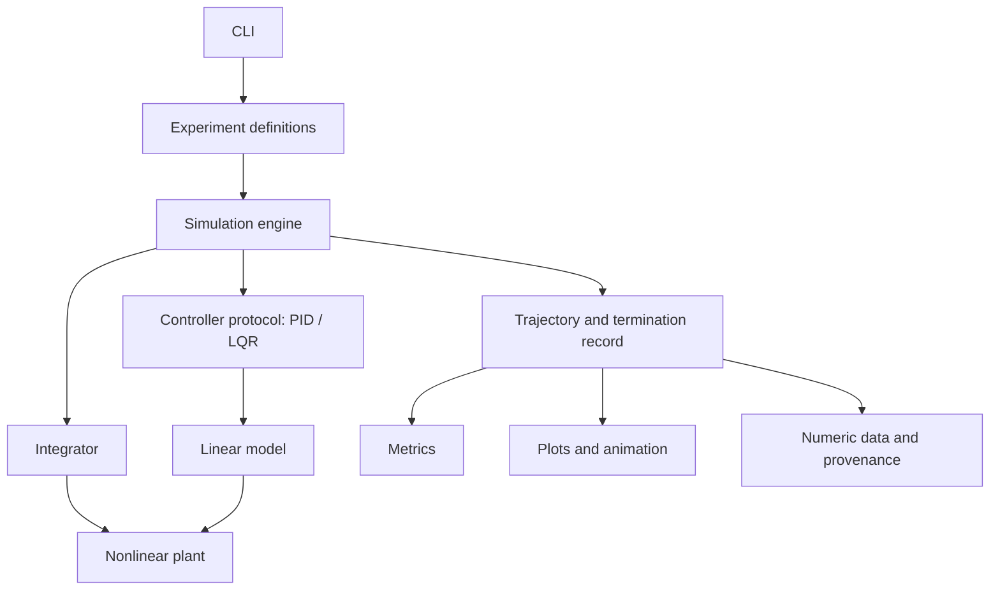

# Architecture foundation

This document describes the audited implementation at
`c678c0c624e50c532cae13a0378dcafc3b4c21ea` and the proposed package boundary.
PR-001 adds documentation and characterization only. The governing decision is
[ADR-0001](decisions/ADR-0001-simulation-contracts.md) (Proposed).

## Physical contract

The state is `[x, x_dot, theta, theta_dot]`, in m, m/s, rad, rad/s.
`M` and `m` are cart and point masses in kg; `l` is pivot-to-point-mass
distance in m; `g` is m/s²; `b` is cart viscous friction in N s/m.
The rod is massless, its pivot frictionless, and theta=0 is upright.
Bob coordinates are `x + l*sin(theta), l*cos(theta)` relative to the pivot
height. Positive force acts toward positive x. At upright rest it produces
`x_ddot = u/M` and `theta_ddot = -u/(M*l)`.

The coupled equations are:

```text
(M+m)*x_ddot + m*l*cos(theta)*theta_ddot
    - m*l*sin(theta)*theta_dot**2 = u - b*x_dot
l*theta_ddot + x_ddot*cos(theta) - g*sin(theta) = 0
```

Eliminating theta_ddot yields the implemented nonlinear RHS. Its Jacobians
at upright rest are:

```text
A = [[0, 1,             0,                  0],
     [0, -b/M,         -m*g/M,             0],
     [0, 0,             0,                  1],
     [0, b/(M*l),       g*(M+m)/(M*l),     0]]
B = [[0], [1/M], [0], [-1/(M*l)]]
```

## Existing behavior

`dynamics.py` owns parameters, equations, linearization and fixed-force RK4.
`controllers.py` imports dynamics and SciPy's CARE solver. LQR applies `-K@s`.
The PID convention uses positive angle and angular-rate feedback; the published
experiments use Ki=0, so these are PD controllers. Positive position gains are
consistent with the coupled plant, rather than independent cart regulation.

At the default parameters the angle-only controller has a neutral position mode
and a small positive continuous linear eigenvalue (about 0.01985/s), so it is
not asymptotically stable in the full state. Position PD and default LQR have
strictly negative continuous linear eigenvalue real parts. The reproduced basin
success counts are 3/30, 23/30 and 25/30 respectively; these are finite-horizon
outcomes, not global regions of attraction.

`simulate.py` evaluates the controller once at each step start, clips its output
to +/-30 N by default, adds an external disturbance, then holds that total force
through all RK4 stages. This is sampled feedback with zero-order hold, not a
continuously reevaluated feedback law. The disturbance is not actuator-limited.
`U` records only clipped actuator force.

PID's integral advances on every call using its own dt. It has no reset or
anti-windup API; trial factories create fresh controllers. Reuse carries state.
Changing simulation dt does not change PID dt automatically.

For n=int(T/dt), the simulator performs n updates and returns n pre-update states
at 0 through (n-1)*dt; the final updated state is discarded. Nonintegral horizons
are truncated. Boundaries are checked after updating, with strict inequalities.
Failure is labeled with the step start, and the failed endpoint is repeated over
the remaining samples with zero padded forces. Initial violations are not
checked separately. These are legacy defects, not proposed contracts.
Success means no recorded failure and final stored |theta|<0.02 rad; it does not
require small position, velocity, or angular rate.

`run_experiments.py` combines configurations, metrics, plotting and output;
its import creates a results directory. `animate.py` also simulates and writes
a GIF on import. Bare sibling imports support script execution, not an installed
package. Requirements are unpinned and figures lack machine-readable provenance.

## Proposed boundaries (not implemented)

```text
src/cartpole_balance/
    model.py          # parameters, RHS, linearization
    controllers.py    # protocol, PID, LQR; explicit state lifecycle
    integration.py    # pure fixed-input integration
    simulation.py     # sample clock, actuator, disturbance, termination
    results.py        # trajectories, input records, termination metadata
    experiments.py    # configurations and fresh controller factories
    metrics.py        # explicit finite-horizon criteria
    visualization.py  # consumes results; no simulation on import
    cli.py            # explicit execution and output paths
```



The core depends on NumPy; LQR additionally uses SciPy. Matplotlib and Pillow
belong only to visualization. CLI and visualization depend on the numerical
core, never the reverse. Result records should permit rendering without reruns.
Separate requested/applied/disturbance forces and termination metadata make
saturation and invalid padded samples observable.

## Evidence and limitations

Characterization runs cover all 90 basin cases, three recovery and three
disturbance trajectories, and four tuning cases. Numeric fixtures preserve
legacy semantics, not physical ground truth. Finite-difference checks and CARE
residuals provide independent mathematical checks. Continuous linear stability
does not establish sampled, saturated, or global nonlinear stability.
Rendering, integration convergence, anti-windup, and precise event localization
are outside PR-001; see the [roadmap](roadmap.md).
